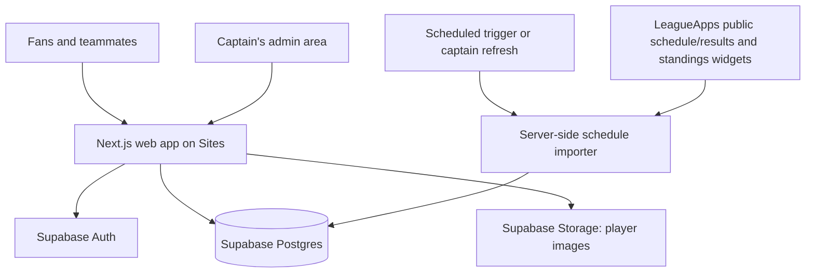

# Mauve FC — architecture sketch

Status: the public club site, captain workflow, LeagueApps imports, invited player
accounts, RSVPs, private drafts, official lineups and member suggestions are live.
The application uses Next.js and Supabase, published on Sites. Home-screen
installation adds a club icon and standalone launch into the private Team area;
it requires connectivity and never creates an offline cache of team data.
See [installation details](home-screen-installation.md), [team accounts](team-accounts.md)
and [backend setup](backend-setup.md). Historical season import and richer private
player cards remain in the team-features phase.

## Product shape

A mobile-first club website with Home, Schedule, Results, Players, and Stats,
plus a private captain's area for maintaining data. The recurring workflow is:
open a match after the game, enter the score and attendance, attribute goals and
optional assists, preview, and publish. Aim for roughly a minute for basic entry.

Confirmed product decisions:

- Public club site; private team tools (confirmed by the owner).
- NYC Soccer is the league for the current Fall season (provided by the owner).
- The main Stats page shows all players to signed-in team members. Public views
  include only approved public-player identities and individual stats, with
  anonymous placeholders for private players. Only captains can edit stats.
- Team matches, goals and goal difference derive exclusively from published
  final results. Team assists sum recorded player assists, including private
  players, with missing/partial coverage shown explicitly.
- Captains manually designate playoffs and optional Quarterfinals, Semifinals
  or Finals. Home’s record and form exclude playoffs; Schedule, Results and Stats
  include them. A published Finals win celebrates the selected season’s title.
- Results distinguish regulation, overtime and penalties. Overtime can finish
  drawn; penalties require a separate win/loss and tied match goals. Shootout
  kicks do not count as team or individual goals.
- Captains mark a season complete or reopen it. Completed seasons display their
  championship, playoff finish or saved league placing on Home.
- Captains remove fixtures and restore removed feed games from a private queue.
  Removed games contribute no result/player totals or team match tools. League
  standings remain the imported league table.
- LeagueApps program URL:
  https://nycsoccer.leagueapps.com/leagues/soccer/5162244-thurs-7-v-7-coed--bbp-group-b

Remaining working assumptions:

- One club initially, with multiple seasons and potentially different formats.
- Published results and approved player stats are public; accounts and RSVPs are private.
- Captains maintain results and stats; players need no account just to have a profile.
- Start with simple match totals rather than requiring live event tracking.
- LeagueApps public widgets are verified below. Manual scheduling also works independently.

## System boundary and stack



| Layer | Proposal | Why |
| --- | --- | --- |
| Application | Next.js App Router + TypeScript | Pages, server actions, and integration endpoints in one codebase |
| Database | Supabase Postgres | Relational match data, SQL analytics, migrations |
| Identity | Supabase Auth | Captain login first; invite-based player login when needed |
| Media | Supabase Storage | Player photos without storing image files in the database |
| UI | Tailwind + shadcn/ui + Motion | Custom club identity, accessible controls, restrained animation |
| Charts | Recharts; custom SVG for pitches | Familiar charts plus football-specific graphics |
| Hosting | Sites | Existing public deployment; Next.js static export with live Supabase reads |

Use server-rendered pages for initial content. Add client-side components for
charts, filters, forms, and later the formation builder. Save the home-screen install
experience for the first useful release; offline editing and background sync are
later features. Never cache authenticated responses in a public PWA cache.

A separate Python API, microservices, realtime infrastructure, and a queue are
unnecessary initially. Python can still query exported data for exploratory analysis.

## Data model

These are conceptual entities, not a finalized SQL schema.

| Entity | Responsibility |
| --- | --- |
| `clubs` | Mauve FC identity and default timezone |
| `club_memberships` | Auth user, club, role: captain or player; optional player link |
| `players` | Stable player identity and public profile; independent of login |
| `private.player_details` | Optional contact email/phone, captain-only relationship note, preferred positions and edit revision; keyed to the stable club player |
| `seasons` | Competition name, dates, format, completion state/revision, captured final league placing |
| `season_roster` | Official membership of a player in a season |
| `private.match_guests` | Club player assigned to one game as a non-roster substitute |
| `matches` | Season, opponent, venue, kickoff, fixture status, publication state, playoff round, removal marker and feed provider key |
| `match_results` | Official and on-field scores, result basis, regulation/overtime/penalty decision, shootout win/loss, adjustment reason |
| `match_player_stats` | Player appearance, goals, assists, optional minutes and keeper details |
| `schedule_sources` | Feed/API configuration, last successful sync, health |
| `external_fixtures` | Source identifier → stable local match ID, imported values and overrides |
| `sync_runs` | Import outcome, counts, timestamp, actionable errors |

One season has many matches and roster entries. One player can appear across
seasons. A match has at most one current result and one stats row per player.
Stats and lineups accept that season’s official roster plus guests explicitly
assigned to that match. A guest assignment reuses the club-wide player identity
without adding roster membership, an account or an appearance. Members can view
the complete club player directory under Players; public responses exclude private
guest identities. Promoting a guest to a season roster preserves their player ID
and does not duplicate any totals. Internal UUIDs remain stable
when the schedule provider changes its identifiers or kickoff times.

Add `availability` when introducing RSVPs, and `lineups`/`lineup_slots` when
introducing formation planning. Neither is needed to publish the first results.
Detailed `match_events` can follow if someone will actually record them.

### Rules that protect the statistics

- **Official versus on-field:** store both score pairs when they differ. Official
  scores drive the club's league record; on-field scores describe the game played.
  A forfeit must not silently invent player goals, appearances, or clean sheets.
- **Regular season versus playoffs:** nullable `matches.playoff_round` is regular
  season when null, otherwise `playoffs`, `quarterfinals`, `semifinals` or `finals`.
  Only captains can set it through the revision-checked fixture workflow.
  LeagueApps imports and fixture restores preserve it; changing only this field
  does not set a schedule override. Home and `public_season_totals` use regular
  results only, while Results and Stats use all published results. League standings
  remain authoritative imported standings. Finals trophies and Home’s champions
  banner derive from the current published winning result, rather than a stored
  flag, so corrections remove them. Confetti respects reduced-motion preferences.
- **Unknown versus zero:** use nullable optional metrics and a capture status for
  attendance, scorers, and assists. No stats rows means unrecorded, not nobody played.
  Keep aggregate coverage visible, for example “assists recorded for 6 of 8 games.”
- **Decider versus goals:** W/D/L follows `penalty_outcome` for a penalty shootout,
  otherwise the official goals. Penalties store tied match goals and a win/loss;
  overtime goals are included in match/player totals. Draft validation permits
  unfinished score edits but publishing and table constraints enforce valid
  deciders. Older stats clients that omit these fields preserve the saved decision.
- **Season finish:** completion is a captain-only revision-checked transaction.
  Capture the connected league’s team position as `final_position` at completion;
  imports never overwrite it. Reopening clears that snapshot and completing again
  captures the latest placing. Completion does not lock result corrections. Home
  derives championships and the last remaining published playoff result from
  current active games; pending games are a fallback only when no playoff result
  remains. Missing playoff scores or league placements remain explicit. Published
  Finals wins retain the existing celebration before or after season completion.
- **Removal versus cancellation:** `matches.removed_at` removes a game from all
  club-facing projections and aggregate views without destroying linked records.
  RLS also excludes removed matches/results from the column-restricted table API.
  Captain-only, revision-checked removal/restore transactions serialize with match
  writes. Triggers reject stale interactive edits to removed games and their
  results, drafts, stats, guests, RSVPs and lineups. Restoration keeps the same UUID
  and recorded data; visibility-only changes rebase current result drafts, while
  real intervening source changes keep stale drafts protected.
- **Feed queue:** server-owned `matches.feed_source` identifies imported fixtures
  independently of provider-specific link tables. LeagueApps registration is
  automatic; future adapters set their own provider key. Captains alone receive
  `removedFixtures`, including source availability when known. Import updates keep
  the removal marker and never resurrect a deleted game. Missing source items
  remain available as explicitly labeled retained records. Manual removals have
  no feed-restore UI. League standings and captured final league place are never
  recomputed from local fixture removals.
- **Totals versus events:** the first source of player goals and assists is the
  per-match totals. If event tracking arrives later, derive those totals from events
  for event-tracked matches; never sum two independent sources for the same match.
- **Result versus publication:** scheduled/completed/cancelled/postponed and
  draft/published are separate states. Unpublished results never affect public stats.
- **Corrections:** publish results and player stats in one database transaction.
  Record editor/time and preserve a small before/after edit history for corrections.
- **Partial attribution:** allow unknown scorers and own goals; warn when attributed
  player goals exceed the on-field team total. Require exact attribution only when
  the captain explicitly marks it complete.
- **Attendance versus RSVP:** planning to attend does not count as an appearance.
- **Minutes and clean sheets:** expose these only when the required playing-time
  and goalkeeper participation data has been recorded. Do not infer a keeper's
  clean sheet from the team score alone.

Store kickoff instants in UTC and preserve the source timezone. Display in
`America/New_York` by default, including daylight saving changes. Do not invent
a kickoff instant when a postponed fixture's new time is still unknown.

## Statistics and read paths

Compute records, goals, assists, appearances, form, and season totals from
published base records using SQL views or query functions. Keep denominator and
result-basis definitions explicit. At this scale, no separate analytics database
or manually maintained leaderboard counters are needed.

Team league position requires standings or other teams' results from a verified
source. Mauve FC's own fixtures are enough to calculate its record, but not its rank.
Label manually maintained standings and their update date if used.

Render pages from a small data-access layer shared by the website and admin area.
After publishing, invalidate affected pages and stats caches. Put player rankings
and chart calculations in reusable queries rather than individual UI components.

## LeagueApps integration

### Verified public source (2026-11-10)

The club maps to LeagueApps team `8032635`, **It’s Coming Home (Lilac)**,
inside program `5162244`. The member API requires authentication, but the
league’s intentional public web widgets expose the full standings and filtered
schedule/results without credentials:

- `https://nycsoccer.leagueapps.com/widgets/standingsContent?lid=5162244`
- `https://nycsoccer.leagueapps.com/ajax/loadSchedule?origin=site&scope=program&programId=5162244&publishedOnly=true&itemType=games_only&teamId=8032635`

These back the owner-provided [standings](https://nycsoccer.leagueapps.com/leagues/5162244/standings)
and [schedule](https://nycsoccer.leagueapps.com/leagues/5162244/schedule) pages.
The first verified snapshot contains eight fixtures from September 17 through
November 12, 2026, six final scores, and nine standings rows. The team is second:
four wins, two draws, 23 goals for, five against, 14 points. October 29 has no
published score; elapsed time alone never makes a fixture completed.

Calendar subscriptions are **not an import source**, per the owner’s instruction.
The existing per-match calendar download is an optional user convenience.

### Import behavior

The server-side `leagueapps-sync` Supabase Edge Function fetches only the two
fixed HTTPS URLs, with timeouts, redirect rejection and bounded response sizes.
A pinned Cheerio adapter verifies the known columns, exact program/team links,
explicit completion states, scores and date context. Kickoffs convert from
America/New_York to UTC with DST validation. Unknown markup, incomplete finals,
login pages or transport failures reject the entire update and preserve the last
successful data. These public pages are not a guaranteed versioned API, so
adapter maintenance may be needed if LeagueApps changes its markup.

An atomic database RPC maps provider game IDs to stable local match UUIDs.
Reschedules update existing matches; repeated imports do not change revisions.
A missing source item is retained, never interpreted as cancellation. The
provider’s full league table and ranking are preserved without guessing tie-breaks.
Source changes retain before/after snapshots in a private audit table.

The importer publishes official team scores with player capture marked
unrecorded. It never creates player appearances, scorers or assists. A captain
publishing a result takes ownership of that result and its player details. A
conflicting future league score is shown for review without overwriting them.
A missing league score is reported as “no final score posted”; it does not prove
that a result was withdrawn. Review links select the exact game and its season,
including navigation within the Results editor and reopening a saved match URL.
Captain fixture edits create an explicit metadata override; restoring league
fixture details in the captain tools resumes automatic metadata updates.

`pg_cron` refreshes hourly at minute 17, using `pg_net`. Captain-only
`request_league_sync` dispatches the same importer, rate-limited to five minutes.
A source row lock prevents overlapping jobs. Each request carries a private,
random, single-use job capability that expires after ten minutes. The function
validates it via a service-only RPC before fetching. No long-lived credential is
stored in cron SQL, and no capability or privileged key reaches the browser.
Elevated database credentials come only from the Edge Function environment.

Pages read Supabase snapshots, never LeagueApps directly. Public snapshots include
standings, source identity, last successful update and sanitized health status.
Captain snapshots additionally expose score conflicts and fixture overrides.
The site remains available with its last good data during a provider outage.

## Access and privacy

Players and individual profile pages use a separate read-only member projection
when a current team member or captain is signed in. It includes all club players,
season-roster membership and active published match-player stats for accurate
totals and appearance histories. The public club projection and public-profile
approval filter stay unchanged. Club directory access remains available to both
team roles, including historical roster players and guests.

`get_member_player_profiles` wraps a private function that checks current club
membership on every request. It returns no drafts, account/email details, editor
identities, removed fixtures or captain restore queue. The client scopes pending
responses to the current account/access state, hides old private data before
effect cleanup, and rechecks on focus and once a minute while visible. Private
profile URLs reveal no player details to public visitors or nonmembers.

Public visitors can see only published club content and approved player profile
fields. Keep emails, account IDs, invite tokens, private notes, and availability
outside public responses. The public club site/private team tools split is confirmed.

Captains can edit club data. Players later manage only their own availability and
allowed profile fields. Authorize each server mutation and enforce equivalent
club-scoped Postgres row-level security policies. Use explicit public projections
or public query functions instead of exposing entire private tables. Check that
views preserve the intended permissions; enabling RLS on base tables alone is not enough.

Normal admin requests use the logged-in user's access. Reserve elevated database
credentials for tightly scoped server-only imports. Player photos intended for the
public site may be public assets; private uploads require private storage policies.

## Suggested code layout

```text
src/
  app/                    # Public routes, admin routes, integration endpoints
  components/             # Shared visual components and interaction primitives
  features/
    matches/              # Fixtures, result entry, publishing
    players/              # Profiles and roster
    stats/                # Queries, definitions, chart data
    availability/         # Added when RSVPs ship
  integrations/leagueapps/ # Reserved for additional provider adapters
  lib/                    # Supabase clients, auth, validation, shared utilities
supabase/
  functions/              # Public-page adapter and protected import worker
  migrations/             # Reviewed schema, access policies, database functions
  seed.sql                # Clearly fictional development data
docs/
  architecture.md
```

Keep one repository and one deployable app. Use versioned database migrations;
local development and preview deployments must use nonproduction data and storage.
Keep a safe export/backup path for results and stats before real team data accumulates.

## Build sequence

1. **Visual prototype:** Home, Schedule, Results, Players, Stats, and the captain's
   result-entry flow with clearly labeled sample data. Establish typography,
   mauve palette, mobile layout, and chart style.
2. **First complete workflow:** migrations, captain auth, manual fixtures, roster,
   transactional result publishing, derived stats, and public/private access.
   Prove that correcting one match updates every affected view.
3. **League integration:** automatic fixtures, official team scores and full league
   standings; deduplication, captain overrides, sync health and hourly refresh.
4. **Team features:** invitations, RSVPs, saved formations, historical season import,
   richer player cards, and home-screen installation.
5. **Optional extras:** voting, awards, AI recap drafts based on recorded facts,
   and detailed event capture. A captain approves generated recaps before publication.

Prioritize tests for official/on-field results, missing versus zero stats,
transactional publishing/corrections, access boundaries, and repeatable imports.
Include a mobile end-to-end check of the captain's entry flow before real use.

## Next milestones

The club now has live accounts, invitations, RSVPs, shared/official lineups,
home-screen installation, player stats, a historical player directory, guest
players, playoffs, season completion and fixture removal/restoration.

Before starting the next season/history milestone, enrich the stable player
record. Captains can record optional email and phone, how the club knows the
player, and multiple preferred playing positions. Roster and directory editors
use the same club-wide record; editing directory details does not add season
membership or game attendance. Invitations automatically retain their required
email, including for existing linked players during the initial backfill. Contact
details survive access revocation and changes between roster/guest roles.

Contact information and relationship notes are captain-only at this stage.
Preferred positions appear in the private directory and team-visible profiles,
with a directory position filter for finding subs. Public-profile approval never
releases contact details, notes or position preferences. Stale detail edits fail
rather than overwrite another captain's changes. A contact email is independent
of the Auth sign-in email.

Work through these milestones in order, with a reviewable slice at each step:

1. **Season management and historical imports — implemented.** See
   [season management](season-management.md) for the unified setup flow, manual
   league tables, previewed LeagueApps imports and season-scoped refresh jobs.
   Create seasons, connect the
   appropriate LeagueApps program/team feed for each, carry over selected roster
   players, and preview historical imports before saving. Reuse stable player
   identities; distinguish missing stats from recorded zeroes. Keep standings
   sourced from the league, and preserve playoff/removal rules.
2. **Club archive and career profiles.** Compare the current season, all seasons
   or a selected set on Stats. Show goals for/against and win/draw/loss records
   using official published results. Use stable player IDs to count teammates
   and guests once across seasons. Individual profiles show career totals, a
   season-by-season chart and filterable appearance history alongside the bio.
   Preserve unknown values and public/member visibility. Captains can export
   scoped results and recorded player rows as CSV. Verify restore from a
   managed database backup in an isolated project before relying on it for recovery.
3. **Player personalization.** Let members edit their own photo, bio, contact
   email/phone, preferred positions and other approved fields. Captains retain
   roster membership and public-profile approval. Relationship notes remain
   captain-only and must use a separate, protected read/write contract. A change
   to sign-in email requires Auth's verified email-change flow; editing a contact
   email must not silently change account identity. Decide contact sharing
   explicitly before making email/phone visible to other team members.
4. **RSVP follow-through.** Add deadlines, opt-in reminders and a captain view of
   unanswered invitations/responses, preserving the distinction between RSVP
   intent and recorded attendance.
5. **Matchday stories and awards.** Add shareable result cards, captain-approved
   recap drafts grounded in recorded facts, and private player-of-the-match
   voting/team awards.

### Mauve FC first, then a second-club pilot

Run the weekly workflow with Mauve FC on phones. Follow a fixture from
availability and unanswered RSVPs through the shared lineup, then publish the
result and stats after the match. Shorten that entry flow before adding opt-in
reminders. Start player personalization with photo, bio and preferred positions.

After Mauve can create, run and close out a season comfortably, invite one
other captain for a pilot. Choose the club from the route or signed-in account
instead of the build-time club ID, and configure club name, crest and colors.
Verify that one account can have different roles in different clubs, and that
each club's private rosters, notes, stats and imports stay isolated. Ask the
pilot captain to create a season, invite a player and publish a result without
assistance. Use that onboarding experience before opening self-service club creation.

## Open decisions

The team-account workflow now lives in `/team/` and `/captain/access/`.
See [private team accounts](team-accounts.md) for invitation, membership, RSVP,
lineup sharing and deployment details. Team data uses member-scoped projections;
it is never included in the public/static snapshot. A verified identity claims
its pending roster invitation when checking team access. RSVPs and formations
remain separate from recorded appearances and result statistics.

- Additional season/program IDs when this competition ends.
- Playing formats and competition rules, including draws, playoffs, and forfeits?
- Who enters stats, and what can they realistically record after each game?

These refine the design; the first prototype can use the working assumptions above.
