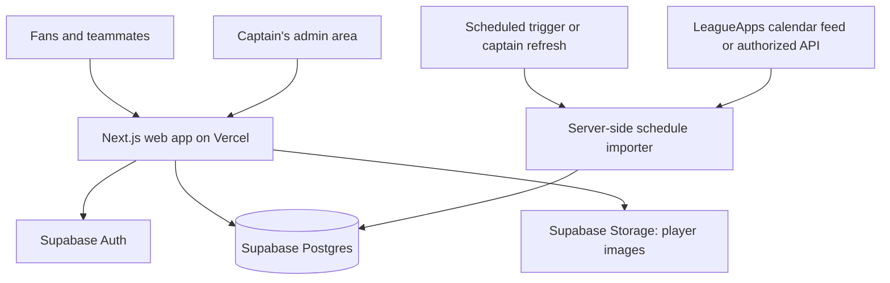

# Mauve FC — architecture sketch

Status: the visual prototype and Supabase workflow implementation are complete in
source. Captain auth, access policies, private drafts, and transactional publishing
are tested locally and the hosted Supabase schema is connected. Auth dashboard
configuration and the first captain’s real email verification remain pending.
League imports remain a later step. See [backend setup](backend-setup.md). See
[the project README](../README.md) for running and verifying the prototype.

## Product shape

A mobile-first club website with Home, Schedule, Results, Players, and Stats,
plus a private captain's area for maintaining data. The recurring workflow is:
open a match after the game, enter the score and attendance, attribute goals and
optional assists, preview, and publish. Aim for roughly a minute for basic entry.

Confirmed product decisions:

- Public club site; private team tools (confirmed by the owner).
- NYC Soccer is the league for the current Fall season (provided by the owner).
- LeagueApps program URL:
  https://nycsoccer.leagueapps.com/leagues/soccer/5162244-thurs-7-v-7-coed--bbp-group-b

Remaining working assumptions:

- One club initially, with multiple seasons and potentially different formats.
- Published results and approved player stats are public; accounts and RSVPs are private.
- Captains maintain results and stats; players need no account just to have a profile.
- Start with simple match totals rather than requiring live event tracking.
- LeagueApps access is unverified. Manual scheduling must work independently.

## System boundary and stack



| Layer | Proposal | Why |
| --- | --- | --- |
| Application | Next.js App Router + TypeScript | Pages, server actions, and integration endpoints in one codebase |
| Database | Supabase Postgres | Relational match data, SQL analytics, migrations |
| Identity | Supabase Auth | Captain login first; invite-based player login when needed |
| Media | Supabase Storage | Player photos without storing image files in the database |
| UI | Tailwind + shadcn/ui + Motion | Custom club identity, accessible controls, restrained animation |
| Charts | Recharts; custom SVG for pitches | Familiar charts plus football-specific graphics |
| Hosting | Vercel | Next.js deployment and preview environments |

Use server-rendered pages for initial content. Add client-side components for
charts, filters, forms, and later the formation builder. Save the home-screen install
experience for the first useful release; offline editing and background sync are
later features. Never cache authenticated responses in a public PWA cache.

A separate Python API, microservices, realtime infrastructure, and a queue are
unnecessary initially. Python can still query exported data for exploratory analysis.

## Data model

These are conceptual entities, not a finalized SQL schema.

| Entity | Responsibility |
| --- | --- |
| `clubs` | Mauve FC identity and default timezone |
| `club_memberships` | Auth user, club, role: captain or player; optional player link |
| `players` | Stable player identity and public profile; independent of login |
| `seasons` | Competition name, dates, format, match length, points rules |
| `season_roster` | Player participation in a season, shirt number, preferred positions |
| `matches` | Season, opponent, venue, kickoff, fixture status, publication state |
| `match_results` | Official and on-field scores, result basis, forfeit/adjustment reason |
| `match_player_stats` | Player appearance, goals, assists, optional minutes and keeper details |
| `schedule_sources` | Feed/API configuration, last successful sync, health |
| `external_fixtures` | Source identifier → stable local match ID, imported values and overrides |
| `sync_runs` | Import outcome, counts, timestamp, actionable errors |

One season has many matches and roster entries. One player can appear across
seasons. A match has at most one current result and one stats row per player.
Stats entries must refer to a player eligible for that match's club/season;
guest players can be added to the roster explicitly. Internal UUIDs remain stable
when the schedule provider changes its identifiers or kickoff times.

Add `availability` when introducing RSVPs, and `lineups`/`lineup_slots` when
introducing formation planning. Neither is needed to publish the first results.
Detailed `match_events` can follow if someone will actually record them.

### Rules that protect the statistics

- **Official versus on-field:** store both score pairs when they differ. Official
  scores drive the club's league record; on-field scores describe the game played.
  A forfeit must not silently invent player goals, appearances, or clean sheets.
- **Unknown versus zero:** use nullable optional metrics and a capture status for
  attendance, scorers, and assists. No stats rows means unrecorded, not nobody played.
  Keep aggregate coverage visible, for example “assists recorded for 6 of 8 games.”
- **Totals versus events:** the first source of player goals and assists is the
  per-match totals. If event tracking arrives later, derive those totals from events
  for event-tracked matches; never sum two independent sources for the same match.
- **Result versus publication:** scheduled/completed/cancelled/postponed and
  draft/published are separate states. Unpublished results never affect public stats.
- **Corrections:** publish results and player stats in one database transaction.
  Record editor/time and preserve a small before/after edit history for corrections.
- **Partial attribution:** allow unknown scorers and own goals; warn when attributed
  player goals exceed the on-field team total. Require exact attribution only when
  the captain explicitly marks it complete.
- **Attendance versus RSVP:** planning to attend does not count as an appearance.
- **Minutes and clean sheets:** expose these only when the required playing-time
  and goalkeeper participation data has been recorded. Do not infer a keeper's
  clean sheet from the team score alone.

Store kickoff instants in UTC and preserve the source timezone. Display in
`America/New_York` by default, including daylight saving changes. Do not invent
a kickoff instant when a postponed fixture's new time is still unknown.

## Statistics and read paths

Compute records, goals, assists, appearances, form, and season totals from
published base records using SQL views or query functions. Keep denominator and
result-basis definitions explicit. At this scale, no separate analytics database
or manually maintained leaderboard counters are needed.

Team league position requires standings or other teams' results from a verified
source. Mauve FC's own fixtures are enough to calculate its record, but not its rank.
Label manually maintained standings and their update date if used.

Render pages from a small data-access layer shared by the website and admin area.
After publishing, invalidate affected pages and stats caches. Put player rankings
and chart calculations in reusable queries rather than individual UI components.

## LeagueApps integration

### Verified public source (2026-11-10)

The club maps to LeagueApps team `8032635`, **It’s Coming Home (Lilac)**,
inside program `5162244`. The member API requires authentication, but the
league’s intentional public web widgets expose the full standings and filtered
schedule/results without credentials:

- `https://nycsoccer.leagueapps.com/widgets/standingsContent?lid=5162244`
- `https://nycsoccer.leagueapps.com/ajax/loadSchedule?origin=site&scope=program&programId=5162244&publishedOnly=true&itemType=games_only&teamId=8032635`

These back the owner-provided [standings](https://nycsoccer.leagueapps.com/leagues/5162244/standings)
and [schedule](https://nycsoccer.leagueapps.com/leagues/5162244/schedule) pages.
The first verified snapshot contains eight fixtures from September 17 through
November 12, 2026, six final scores, and nine standings rows. The team is second:
four wins, two draws, 23 goals for, five against, 14 points. October 29 has no
published score; elapsed time alone never makes a fixture completed.

Calendar subscriptions are **not an import source**, per the owner’s instruction.
The existing per-match calendar download is an optional user convenience.

### Import behavior

The server-side `leagueapps-sync` Supabase Edge Function fetches only the two
fixed HTTPS URLs, with timeouts, redirect rejection and bounded response sizes.
A pinned Cheerio adapter verifies the known columns, exact program/team links,
explicit completion states, scores and date context. Kickoffs convert from
America/New_York to UTC with DST validation. Unknown markup, incomplete finals,
login pages or transport failures reject the entire update and preserve the last
successful data. These public pages are not a guaranteed versioned API, so
adapter maintenance may be needed if LeagueApps changes its markup.

An atomic database RPC maps provider game IDs to stable local match UUIDs.
Reschedules update existing matches; repeated imports do not change revisions.
A missing source item is retained, never interpreted as cancellation. The
provider’s full league table and ranking are preserved without guessing tie-breaks.
Source changes retain before/after snapshots in a private audit table.

The importer publishes official team scores with player capture marked
unrecorded. It never creates player appearances, scorers or assists. A captain
publishing a result takes ownership of that result and its player details. A
conflicting future league score is shown for review without overwriting them.
Captain fixture edits create an explicit metadata override; restoring league
fixture details in the captain tools resumes automatic metadata updates.

`pg_cron` refreshes hourly at minute 17, using `pg_net`. Captain-only
`request_league_sync` dispatches the same importer, rate-limited to five minutes.
A source row lock prevents overlapping jobs. Each request carries a private,
random, single-use job capability that expires after ten minutes. The function
validates it via a service-only RPC before fetching. No long-lived credential is
stored in cron SQL, and no capability or privileged key reaches the browser.
Elevated database credentials come only from the Edge Function environment.

Pages read Supabase snapshots, never LeagueApps directly. Public snapshots include
standings, source identity, last successful update and sanitized health status.
Captain snapshots additionally expose score conflicts and fixture overrides.
The site remains available with its last good data during a provider outage.

## Access and privacy

Public visitors can see only published club content and approved player profile
fields. Keep emails, account IDs, invite tokens, private notes, and availability
outside public responses. The public club site/private team tools split is confirmed.

Captains can edit club data. Players later manage only their own availability and
allowed profile fields. Authorize each server mutation and enforce equivalent
club-scoped Postgres row-level security policies. Use explicit public projections
or public query functions instead of exposing entire private tables. Check that
views preserve the intended permissions; enabling RLS on base tables alone is not enough.

Normal admin requests use the logged-in user's access. Reserve elevated database
credentials for tightly scoped server-only imports. Player photos intended for the
public site may be public assets; private uploads require private storage policies.

## Suggested code layout

```text
src/
  app/                    # Public routes, admin routes, integration endpoints
  components/             # Shared visual components and interaction primitives
  features/
    matches/              # Fixtures, result entry, publishing
    players/              # Profiles and roster
    stats/                # Queries, definitions, chart data
    availability/         # Added when RSVPs ship
  integrations/leagueapps/ # Reserved for additional provider adapters
  lib/                    # Supabase clients, auth, validation, shared utilities
supabase/
  functions/              # Public-page adapter and protected import worker
  migrations/             # Reviewed schema, access policies, database functions
  seed.sql                # Clearly fictional development data
docs/
  architecture.md
```

Keep one repository and one deployable app. Use versioned database migrations;
local development and preview deployments must use nonproduction data and storage.
Keep a safe export/backup path for results and stats before real team data accumulates.

## Build sequence

1. **Visual prototype:** Home, Schedule, Results, Players, Stats, and the captain's
   result-entry flow with clearly labeled sample data. Establish typography,
   mauve palette, mobile layout, and chart style.
2. **First complete workflow:** migrations, captain auth, manual fixtures, roster,
   transactional result publishing, derived stats, and public/private access.
   Prove that correcting one match updates every affected view.
3. **League integration:** automatic fixtures, official team scores and full league
   standings; deduplication, captain overrides, sync health and hourly refresh.
4. **Team features:** invitations, RSVPs, saved formations, historical season import,
   richer player cards, and home-screen installation.
5. **Optional extras:** voting, awards, AI recap drafts based on recorded facts,
   and detailed event capture. A captain approves generated recaps before publication.

Prioritize tests for official/on-field results, missing versus zero stats,
transactional publishing/corrections, access boundaries, and repeatable imports.
Include a mobile end-to-end check of the captain's entry flow before real use.

## Open decisions

- Additional season/program IDs when this competition ends.
- Playing formats and competition rules, including draws, playoffs, and forfeits?
- Who enters stats, and what can they realistically record after each game?

These refine the design; the first prototype can use the working assumptions above.
